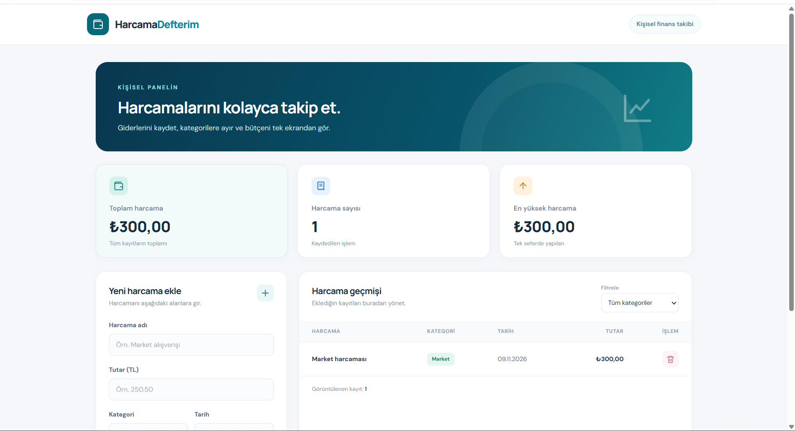

# Harcama Defterim

**Harcama Defterim**, kişisel harcamaların tek ekranda kaydedilebildiği ve takip edilebildiği basit bir web uygulamasıdır. Yapay zekâ destekli web geliştirme eğitimi kapsamında hazırlanmıştır.

## Özellikler

- Harcama adı, tutarı, kategori ve tarih bilgisiyle yeni harcama ekleme
- Kayıtlı harcamaları listeleme
- Harcamaları kategoriye göre filtreleme
- Harcama silme
- Toplam harcama, işlem sayısı ve en yüksek harcamayı görüntüleme
- Tarayıcının LocalStorage özelliği ile kayıtları aynı tarayıcıda saklama
- Masaüstü ve mobil ekranlara uygun tasarım

> Not: Veriler bir sunucuya gönderilmez. Kayıtlar kullanılan tarayıcıda saklanır; farklı cihazlara otomatik aktarılmaz. Tarayıcının site verileri silinirse kayıtlar da silinebilir.

## Kullanılan teknolojiler

- React (arayüz geliştirme)
- Vite (geliştirme ve derleme aracı)
- JavaScript / JSX
- HTML ve saf CSS
- LocalStorage (tarayıcıda veri saklama)
- VS Code (geliştirme ortamı)
- GitHub (kaynak kod paylaşımı)
- Netlify (canlı yayın)

## Kurulum

1. Node.js LTS sürümünü kurun.
2. Proje klasörünü VS Code ile açın.
3. Terminalde bağımlılıkları yükleyin:

   ```bash
   npm install
   ```

4. Geliştirme sunucusunu başlatın:

   ```bash
   npm run dev
   ```

5. Terminalde görünen yerel adresi (genellikle `http://localhost:5173`) tarayıcıda açın.

### Canlı sürüm için derleme

```bash
npm run build
```

Bu komut `dist` klasörünü oluşturur. Netlify üzerinde build komutu `npm run build`, yayın klasörü `dist` olacak şekilde yapılandırılmıştır.

## Yapay zekânın kullanıldığı aşamalar

Bu projede **ChatGPT** aşağıdaki aşamalarda geliştirme asistanı olarak kullanılmıştır:

1. Yönergenin analiz edilmesi ve uygulama fikrinin belirlenmesi
2. React bileşenlerinin ve LocalStorage veri modelinin planlanması
3. Form, liste, özet kartları ve filtreleme için örnek kod hazırlanması
4. CSS yerleşimi ve mobil uyumluluk için tasarım önerilerinin geliştirilmesi
5. Kurulum ve dokümantasyon metninin oluşturulması

Üretilen kodun doğru çalışması; uygulamanın yerel ortamda açılması, harcama ekleme/silme ve sayfa yenileyince verilerin korunması gibi adımlarla kontrol edilmelidir.

## Ekran görüntüsü

Uygulamanın ekran görüntüsü teslimden önce `screenshots/ekran-goruntusu.png` yoluna eklenmelidir.

<!-- Ekran görüntüsü eklendikten sonra aşağıdaki satır etkinleşir: -->
<!--  -->

## Proje bağlantıları

GitHub ve canlı uygulama bağlantıları yayın yapıldıktan sonra eklenmelidir.
